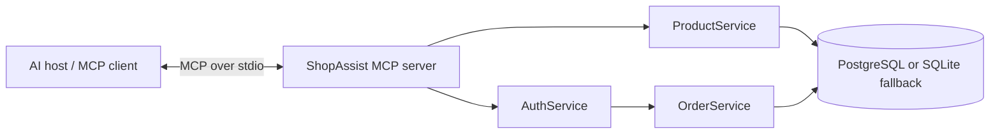

# ShopAssist MCP integration

## Architecture



The server is a local process launched by an MCP host with `python -m src.mcp_server`. It uses the official MCP Python SDK v2 and its default stdio transport. The host and server exchange protocol messages through stdin/stdout; diagnostics must use stderr/logging.

## Exposed tools

| Tool | Authentication | Behavior |
|---|---|---|
| `search_products(query, category, in_stock)` | Public | Searches the product service and returns at most ten catalog results. |
| `lookup_order(order_id)` | Required | Validates the configured ShopAssist session token, derives its customer identity, and returns only an order owned by that customer. |

The order tool does not accept an email or customer ID. A missing, invalid, expired, or revoked session is rejected. An order owned by another customer produces the same not-found response as an unknown order. The tool is read-only and omits the delivery address.

## Customer authentication

Configure `MCP_CUSTOMER_SESSION_TOKEN` in the MCP host's environment for the customer session. The server validates that token against the existing `auth_sessions` table on every order lookup through `AuthService.get_customer_for_token`. The token is a bearer credential: configure it only in a trusted local host, do not commit it, and revoke the ShopAssist session to invalidate it. The server intentionally uses a per-process customer identity; this stdio setup is for a local authenticated host, not a shared multi-user network endpoint.

Example host configuration (replace the path for the local checkout and supply an active ShopAssist session token through the host's secret/environment feature):

```json
{
  "mcpServers": {
    "shopassist": {
      "command": "C:\\path\\to\\ShopAssist\\.venv\\Scripts\\python.exe",
      "args": ["-m", "src.mcp_server"],
      "cwd": "C:\\path\\to\\ShopAssist",
      "env": {
        "MCP_CUSTOMER_SESSION_TOKEN": "<customer session token>"
      }
    }
  }
}
```

The Python server loads its ordinary database settings from the project's `.env`. MCP hosts that launch subprocesses with a restricted environment must set the customer token explicitly.

## Validation

- `python -m evaluation.mcp_security_checks` uses a disposable SQLite database and checks tool registration, public product search, unauthenticated rejection, an authenticated owner lookup, cross-customer isolation, and invalid-session rejection.
- `python -m evaluation.mcp_smoke` connects the official Python SDK `Client` to the server and checks discovery and tool calls. On the current Windows Python environment, the async SDK client harness did not complete (the Python event loop remained blocked), so discovery through the wire/client transport still needs a successful run in a working async runtime.
- The server's launch entrypoint defaults to stdio. No network listener is exposed by this integration.
