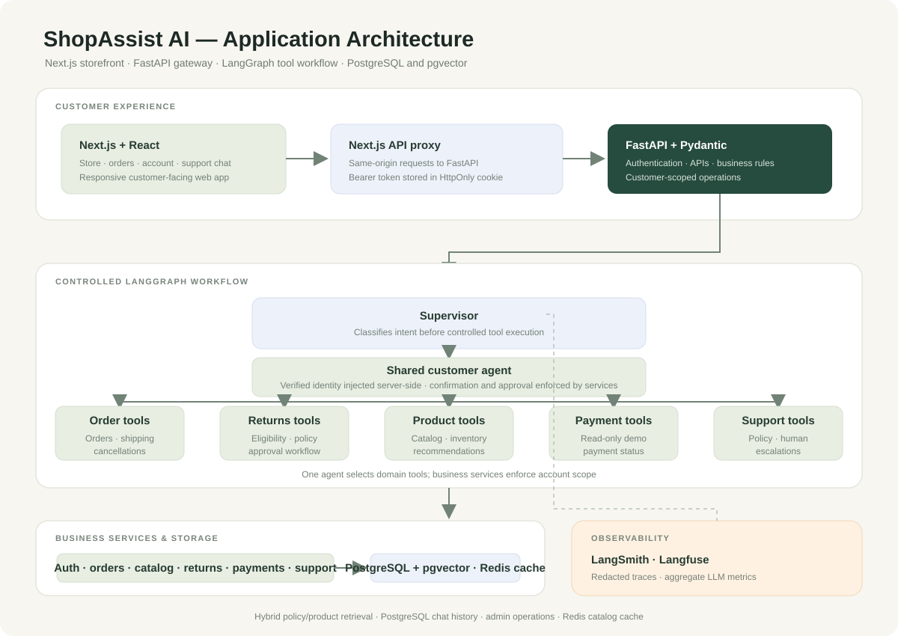

# ShopAssist AI — Autonomous E-commerce Customer Service Agent

[](https://python.org)
[](https://langchain.com/langgraph)
[](LICENSE)

> A portfolio MVP for e-commerce customer support, built with **Next.js**, **FastAPI**, **LangGraph**, **SQLite/PostgreSQL**, **LangSmith**, and **Langfuse**.

---

## 📖 Table of Contents

- [Architecture](#-architecture)
- [How It Works](#-how-it-works)
- [Features](#-features)
- [Build Roadmap](#-build-roadmap)
- [Quick Start](#-quick-start)
- [API Reference](#-api-reference)
- [Project Structure](#-project-structure)
- [Sample Queries](#-sample-queries)
- [Database Schema](#-database-schema)
- [Testing](#-testing)
- [Observability](#-observability)
- [Evaluation and project status](#evaluation-and-project-status)
- [Support operations report](evaluation/SUPPORT_OPERATIONS_REPORT.md)
- [MCP integration guide](docs/MCP_INTEGRATION.md)
- [Support operations workflow](docs/SUPPORT_OPERATIONS.md)
- [Portfolio materials](#portfolio-materials)
- [Tech Stack](#-tech-stack)
- [License](#-license)

---

## 🏗️ Architecture



The customer UI calls the authenticated FastAPI gateway. The LangGraph is a single controlled workflow: a supervisor classifies intent, one tool-enabled agent handles domain actions, and a response node formats the result. Customer identity is injected server-side, chat history is persisted per account, and order operations remain account-scoped. PostgreSQL + pgvector is the configured local database, with Redis for product caching. SQLite remains available for isolated development and a verified copy command migrates it to PostgreSQL. Policy and live product evidence are retrieved with citations.

| Layer | Technology | Role |
|---|---|---|
| **Customer interface** | Next.js + React | Store catalog, customer account/order pages, and support chat |
| **Web API proxy** | Next.js route handler | Same-origin API calls with the access token held in an HttpOnly cookie |
| **Gateway** | FastAPI + Pydantic v2 | `POST /api/v1/chat` — async, typed, CORS-enabled |
| **Agent** | LangGraph StateGraph | Supervisor → shared tool-enabled agent → grounded response |
| **LLM** | Groq by default; Gemini/Ollama/OpenAI optional | Configurable chat and tool calling |
| **Tools** | Domain-specific tools | Order/shipping, returns, product/inventory, payment status, support |
| **Storage** | PostgreSQL 17 + pgvector | Customer accounts, orders, shipments, products, simulated payments, returns, tickets, conversations, embedded knowledge chunks |
| **Cache** | Redis 7 | Product search cache with bounded TTL and database fallback |
| **Observability** | LangSmith + Langfuse; local metrics endpoint | Redacted workflow traces, per-node latency, aggregate token usage and optional cost estimates |

---

## 🧠 How It Works

### Controlled tool workflow

```
User: "Where is my order ORD-1002?"
  │
  ▼
Supervisor (LLM)
  → classifies: intent = "order_status"
  → routes to shared customer agent
  │
  ▼
Customer Agent (LLM + declared function calling)
  → selects: lookup_order("ORD-1002")
  → server injects the verified account identity
  → checks ownership and queries the configured database
  │
  ▼
Response Node
  → formats the confirmed tool result in English
  │
  ▼
User receives structured answer
```

### Key Design Decisions

**Why one controlled workflow?** Intent classification, tool execution, and response formatting are explicit graph nodes. The shared agent has a declared set of domain tools, while identity and action approvals are enforced by the API and services rather than model-generated arguments.

**Tool domains:** Order and shipping, returns, catalog and inventory, simulated payment status, and support escalation. Legacy specialist helpers remain in the codebase for focused compatibility tests but are not graph nodes.

**Why function calling?** One shared agent selects among an explicit domain tool registry. Account identity, permission checks, confirmation, and human approval remain enforced in the API and services.

**Grounded answers:** Policy files in `knowledge/` and active catalog items are indexed into the database. The configured PostgreSQL index contains 21 embedded chunks; Gemini generates embeddings and pgvector performs vector search alongside keyword retrieval. If embeddings are unavailable, retrieval falls back to keywords. Retrieved excerpts carry source paths, and unsupported policy questions should receive an explicit no-match response.

**Response language:** Customer-facing assistant responses are written in English.

**Why retry?** The `after_tools` router checks for errors. If a tool fails (e.g., SQLite locked), it loops back up to 3 times before returning a graceful fallback message.

---

## ✨ Features

| Feature | Detail |
|---|---|
| 🧭 **Controlled LangGraph workflow** | Intent supervisor, one shared tool-enabled customer agent, grounded response node |
| 🛍️ **Customer shop** | Search and filter the product catalog by category and availability; view live demo inventory |
| 📦 **Order history** | Signed-in customers can review their own orders and item details |
| 💳 **Payment status** | Account-scoped simulated payment status; no real charging or refunds |
| 🔄 **Retry Loop** | Up to 3 retries on tool errors — graph loops back automatically |
| 🇬🇧 **English Responses** | Customer-facing responses use clear, professional English |
| 🗄️ **PostgreSQL + pgvector** | PostgreSQL is configured for the local app; SQLite-to-PostgreSQL migration is verified |
| 📊 **LangSmith + Langfuse** | Redacted workflow stages, intent category, status, and latency |
| 🧪 **Automated test suite** | Service, authentication, database, workflow, and evaluation tests |
| 🚀 **Single Command** | `python run.py` starts API + UI + opens browser |
| 🔐 **Customer Accounts** | Email verification, expiring bearer sessions, logout/revocation, and account-scoped order tools |
| 💬 **Conversation history** | Persistent, customer/session-scoped chat with a clear-history action |
| 📚 **Cited knowledge retrieval** | Returns/shipping/payment/support policies and live product facts with source paths; no-match responses are explicit |
| 🧑‍💼 **Admin operations** | HttpOnly admin session, ticket queue/status updates, return approvals, metrics, and audit trail |
| 🧭 **AI-assisted ticket triage** | Redacted customer message → suggested category, priority, summary, and team; model failures never block escalation |
| 🧑‍⚖️ **Human-controlled queue** | Staff can override ticket category and priority; decisions are audited and original AI suggestions remain visible |
| 📈 **Support workload view** | Open backlog by category, high-priority count, tickets awaiting triage, and pending return approvals |
| ⚡ **Redis cache** | 60-second catalog query caching; database reads continue when Redis is unavailable |
| 🧪 **110-scenario live evaluation** | Resumable Groq supervisor intent/routing evaluation with strict JSON output |
| 🔌 **ShopAssist MCP server** | Local stdio tools for product search and session-scoped order lookup |
| 🐳 **Docker and CI** | Compose stack for Next.js, FastAPI, PostgreSQL/pgvector and Redis; GitHub Actions for tests and builds |

---

## 🧭 Build Roadmap

The existing application is the starting foundation. The project will be developed in verified milestones rather than replacing working pieces all at once.

| Milestone | Scope | Status |
|---|---|---|
| 1. Secure support foundation | Email-verified customer accounts, account-scoped chat/order tools, cancellation and return confirmation, support tickets | Complete |
| 2. Store workflows and data | Product catalog/inventory; simulated payment lookup; safe customer operations | Complete |
| 3. Customer shop experience | Product browsing, inventory pages, order/account screens | Complete |
| 4. Target architecture migration | Single controlled LangGraph workflow, PostgreSQL + pgvector | Implemented; live PostgreSQL integration runs in CI |
| 5. Grounded support and operations | Policy/product RAG, conversation history, admin dashboard, action history and metrics | Implemented for the demo workflows |
| 6. Evaluation and deployment | 110 scenario evaluations, Docker Compose, GitHub Actions, readiness checks | Routing and retrieval have measured reports; CI Compose smoke is configured but local Docker startup and public deployment remain unverified |

Groq is the default chat provider; Gemini, Ollama, and OpenAI are optional alternatives. The current PostgreSQL index contains 21 embedded knowledge chunks; Gemini is used for embeddings. Payment status and shipment tracking use demo records; SMTP is the only external notification integration. Redis handles product caching, while authenticated sessions remain in PostgreSQL and no background job queue is configured. This is a portfolio demo: admin access uses a shared key, payment/refund actions are simulated, and production deployment requires real payment and shipping providers, staff identity management, secrets, backups, privacy/retention controls, and operational monitoring.

### Optional PostgreSQL setup

The checked-in `.env.example` leaves the database unset for SQLite compatibility. For this local checkout, PostgreSQL 17 + pgvector and Redis are configured in `.env`. To start them with Compose:

```powershell
$env:POSTGRES_PASSWORD = "choose-a-local-password"
docker compose up -d postgres
```

The local checkout uses PostgreSQL port `55432` because lower ports were unavailable on this machine, and Redis port `6379`. Its existing SQLite records have been copied and verified in PostgreSQL; the SQLite file remains unchanged. PostgreSQL and Redis use named Docker volumes. To migrate another SQLite database, set `DATABASE_URL`, stop the app, then run `python -m src.services.migrate_sqlite_to_postgres`.

For the local portfolio dataset, run `python -m scripts.seed_demo_business`. It creates fictional, verified customer accounts with hashed passwords, product stock, orders, shipment events, payment statuses, and sample return/cancellation/support cases in PostgreSQL. Local login credentials are written to a git-ignored file at `catalog/demo_accounts.local.csv`. These records and stock levels are demonstration data, not real merchant/customer records. See [support operations](docs/SUPPORT_OPERATIONS.md) for the triage workflow and limitations.

Knowledge ingestion synchronizes policy and active product records, cleans markdown, and chunks content at section/paragraph boundaries into `knowledge_chunks`. With PostgreSQL/pgvector and `GEMINI_API_KEY` configured, run `python -m src.services.knowledge_service` to generate 768-dimensional Gemini embeddings in batches. Retrieval combines keyword and cosine rankings with reciprocal-rank fusion, then reranks candidates and includes source paths. If embeddings are missing or vector search fails, it falls back to keyword retrieval. No customer conversations or private order data are indexed.

Run the seeded known-answer keyword benchmark with `python -m evaluation.rag_quality`, or evaluate the configured embedded PostgreSQL index with `python -m evaluation.rag_quality --postgres`. Each writes per-question results and Recall@k/MRR to its own JSON report under `evaluation/live_results/`.

### Model Context Protocol (MCP)

The local server exposes `search_products` and authenticated `lookup_order` tools over stdio. Set a valid ShopAssist customer session as `MCP_CUSTOMER_SESSION_TOKEN` in the trusted MCP host configuration; the server derives customer identity from that session and never accepts an email argument. See [MCP_INTEGRATION.md](MCP_INTEGRATION.md). Run `python -m evaluation.mcp_security_checks` for isolated authentication and data-isolation checks. `python -m evaluation.mcp_smoke` exercises discovery and tool calls with the official SDK client.

### Docker stack

Set `POSTGRES_PASSWORD`, `GEMINI_API_KEY`, `AUTH_SECRET_KEY`, SMTP settings, and `ADMIN_API_KEY` in `.env`, then run:

```powershell
docker compose up --build
```

Open the storefront at http://localhost:3000 and the API docs at http://localhost:8000/docs. The local Compose stack listens only on loopback. Compose selects PostgreSQL and Redis for the containerized API and seeds its demo catalog if the database is empty; it does not automatically copy a host SQLite database.

The admin dashboard is at http://localhost:3000/admin. Sign in with `ADMIN_API_KEY`; the browser stores it only in an HttpOnly, SameSite cookie for same-origin proxy requests.

### Evaluation

The live Groq routing runner uses a strict JSON schema, saves a checkpoint after each completed scenario, retries provider fallbacks, and resumes matching checkpoints:

```powershell
python -m evaluation.run_live --delay-seconds 8 --retry-delay-seconds 65 --failure-retries 2
```

The latest run scored **110/110 (100%)** for supervisor intent and routing, compared with the corrected baseline **101/110 (91.8%)**. This does not measure tool selection, tool arguments, tool execution, final answers, or policy compliance. It uses a temporary seeded SQLite database when PostgreSQL is unavailable and never saves offline fallback answers as live results. Live evaluation can incur provider usage and is intentionally separate from the unit-test command.

---

## 🚀 Quick Start

### Prerequisites

- Python 3.11+
- Node.js 20.9+ and npm
- Groq API key ([create one in Groq Console](https://console.groq.com/keys)); Gemini is used for optional embeddings; Ollama and OpenAI are optional chat alternatives
- (Optional) LangSmith and/or Langfuse accounts for workflow tracing

### 1. Clone & Setup

```bash
git clone https://github.com/m-peker/ecommerce-ai-agent.git
cd ecommerce-ai-agent
python -m venv venv
source venv/bin/activate      # Mac/Linux
venv\Scripts\activate         # Windows
pip install -r requirements.txt
npm install
```

### 2. Configure

```bash
cp .env.example .env
```

Edit `.env` and configure Groq:
```env
# Groq is the default chat provider.
LLM_PROVIDER=groq
GROQ_API_KEY=your-groq-api-key
GROQ_MODEL=openai/gpt-oss-20b
# Optional local Ollama alternative (install Ollama and pull the model first):
# LLM_PROVIDER=ollama
# OLLAMA_MODEL=llama3.2
# OLLAMA_BASE_URL=http://localhost:11434
# LLM_PROVIDER=openai
# OPENAI_API_KEY=your-openai-api-key
# OPENAI_MODEL=gpt-4o-mini
# Gemini can be used for embeddings or as an alternate chat provider:
# GEMINI_API_KEY=your-gemini-api-key
# GEMINI_MODEL=gemini-3.8-flash
AUTH_SECRET_KEY=<random secret, at least 32 characters>
SMTP_HOST=<your SMTP host>
SMTP_PORT=587
SMTP_USERNAME=<your SMTP username>
SMTP_PASSWORD=<your SMTP password>
SMTP_SENDER=<verified sender address>
```

The Next.js storefront supports account registration, email verification, sign-in, sign-out, product browsing, order history, and support chat. A same-origin Next.js API proxy keeps the FastAPI bearer token in an HttpOnly cookie. Existing demo orders can be accessed by registering with the same email address as the order and verifying that email.

> **Optional — LangSmith and Langfuse tracing:**  
> Add the desired service credentials listed in `.env.example` to `.env`, then restart FastAPI.  
> Only redacted node names, timings, status, and allowlisted intent categories are exported.

### 3. Run

```bash
python run.py
```

Opens:
- **API** → http://localhost:8002/docs (Swagger UI)
- **Storefront** → http://localhost:3000 (Next.js)

To run the services separately, use `uvicorn src.main:app --reload --port 8002` and `npm run dev`.

### 4. Test

```bash
pytest tests/ -v    # PostgreSQL integration skips unless TEST_DATABASE_URL is reachable
```

---

## 📡 API Reference

| Method | Endpoint | Description |
|---|---|---|
| `GET` | `/api/v1/health` | Health check → `{"status":"ok","version":"1.0.0"}` |
| `GET` | `/api/v1/ready` | Database readiness and optional Redis cache status |
| `GET` | `/api/v1/admin/llm-metrics` | Admin-key protected aggregate LLM usage and latency metrics |
| `POST` | `/api/v1/auth/register` | Register and email a verification code |
| `POST` | `/api/v1/auth/verify-email` | Verify an email address |
| `POST` | `/api/v1/auth/login` | Sign in and receive an expiring bearer token |
| `GET` | `/api/v1/auth/me` | Get the signed-in customer profile |
| `POST` | `/api/v1/auth/logout` | Revoke the current session |
| `GET` | `/api/v1/products` | Search and filter the product catalog and inventory |
| `GET` | `/api/v1/products/categories` | List active product categories |
| `GET` | `/api/v1/orders/mine` | List only the signed-in customer's orders |
| `POST` | `/api/v1/orders/checkout` | Create an unpaid demo order after validating catalog stock and prices |
| `POST` | `/api/v1/chat` | Authenticated customer chat |
| `POST` | `/api/v1/chat/guest` | Public product and policy chat without account access |
| `GET` | `/api/v1/chat/history` | Retrieve the signed-in customer’s session history |
| `DELETE` | `/api/v1/chat/history` | Clear the signed-in customer’s session history |
| `POST` | `/api/v1/orders/cancellation-requests` | Request cancellation of an eligible order |
| `POST` | `/api/v1/cancellation-requests/{id}/confirm` | Confirm a pending cancellation |
| `POST` | `/api/v1/returns/requests` | Request a return for an eligible order |
| `POST` | `/api/v1/returns/{rma}/confirm` | Confirm a pending return |
| `POST` | `/api/v1/admin/returns/{rma}/approve` | Admin approval; requires `X-Admin-Key` |
| `GET` | `/api/v1/admin/dashboard` | Order/customer/ticket/return metrics; requires admin key |
| `GET` | `/api/v1/admin/tickets` | List and filter support tickets; requires admin key |
| `PATCH` | `/api/v1/admin/tickets/{ticket_id}` | Update ticket status and record an audit event |
| `GET` | `/api/v1/admin/returns/pending` | List customer-confirmed returns awaiting approval |
| `GET` | `/api/v1/admin/audit` | List recent admin actions |
| `POST` | `/api/v1/support/tickets` | Escalate a request to support |

### Request

```json
{
  "message": "Where is my package FDX-78901234?",
  "session_id": "optional-session-id"
}
```

### Response

```json
{
  "response": "Hello! Here is the tracking information...",
  "intent": "shipping_tracking",
  "order_id": "",
  "tracking_number": "FDX-78901234",
  "customer_email": "",
  "tool_results": {
    "track_shipment": "✅ **FedEx** — FDX-78901234\n📌 Status: DELIVERED..."
  }
}
```

### cURL

```bash
curl -X POST http://localhost:8002/api/v1/auth/login \
  -H "Content-Type: application/json" \
  -d '{"email":"sarah@example.com","password":"your-password"}'

curl -X POST http://localhost:8002/api/v1/chat \
  -H "Content-Type: application/json" \
  -H "Authorization: Bearer <access-token>" \
  -d '{"message":"What is the status of ORD-1002?"}'
```

### Confirmed business workflows

These demo endpoints keep an order unchanged until the customer confirms the action:

1. `POST /api/v1/orders/cancellation-requests` with `order_id` creates a pending cancellation for the signed-in customer.
2. `POST /api/v1/cancellation-requests/{cancellation_id}/confirm` with the same bearer token performs the cancellation. Only `confirmed` orders can be cancelled.
3. `POST /api/v1/returns/requests` with `order_id` and a return `reason` creates a pending request for the signed-in customer.
4. `POST /api/v1/returns/{rma_number}/confirm` sends the customer-confirmed request to human approval.
5. `POST /api/v1/admin/returns/{rma_number}/approve` requires the `X-Admin-Key` header. Set `ADMIN_API_KEY` in `.env` to enable it. Approval is recorded in the configured database; this demo does **not** transfer money.
6. `POST /api/v1/support/tickets` records an escalation and returns its ticket ID.

Customer operations and chat use an email-verified account and an expiring, revocable bearer session. The admin dashboard uses a shared key stored in an HttpOnly cookie and records privileged changes in an audit table; this is not a replacement for production identity and role management. Do not use this portfolio app with real customer/payment data without production authorization, rate limiting, and data-retention controls.

---

## 📁 Project Structure

```
shopassist-ai/
├── .env.example                 # Environment template (safe to commit)
├── .env.local.example            # Next.js backend API URL template
├── .gitignore                   # Ignores .env, __pycache__, *.db
├── README.md
├── requirements.txt
├── package.json                  # Next.js scripts and dependencies
├── package-lock.json             # Pinned JavaScript dependency graph
├── tsconfig.json                 # TypeScript configuration
├── next.config.ts                # Next.js configuration
├── run.py                       # Single-command launcher (API + UI)
├── images/
│   ├── architecture.svg         # Current application architecture diagram
│   ├── demo-1.png               # Legacy agent screenshot; not current storefront UI
│   └── demo-2.png               # Legacy agent screenshot; not current storefront UI
├── docs/
│   ├── PORTFOLIO_OVERVIEW.md    # Architecture, workflow, RAG, evidence, and limits
│   ├── DEMO_SCRIPT.md           # Four-minute demo walkthrough
│   └── CV_PROJECT_DESCRIPTION.md # CV and LinkedIn project copy
├── knowledge/                   # Source Markdown for policy/product retrieval
├── evaluation/
│   ├── scenarios.json           # 110 intent/routing evaluation prompts
│   ├── run_live.py              # Live model routing evaluator
│   └── rag_quality.py           # Known-answer retrieval evaluator
├── compose.yaml                 # API, UI, PostgreSQL/pgvector, Redis
├── Dockerfile.api
├── Dockerfile.web
├── src/
│   ├── config.py                # Pydantic settings (reads .env)
│   ├── main.py                  # FastAPI app + startup/shutdown hooks
│   ├── agent/
│   │   ├── __init__.py
│   │   ├── state.py             # Shared AgentState TypedDict
│   │   ├── llm.py               # Shared lazy LLM clients
│   │   ├── supervisor.py        # Intent classification and delegation
│   │   ├── response.py          # Final customer-facing response
│   │   ├── tools.py             # Shared tool-enabled agent tool definitions
│   │   ├── graph.py             # Single supervisor → tool agent → response workflow
│   │   └── specialists/         # Legacy helpers retained for compatibility tests
│   ├── services/
│   │   ├── __init__.py
│   │   ├── database.py          # SQLite/PostgreSQL connection layer and schema
│   │   ├── migrate_sqlite_to_postgres.py # Verified, non-destructive data copy
│   │   ├── order_service.py     # Order CRUD + search
│   │   ├── shipping_service.py  # Carrier tracking lookup
│   │   ├── returns_service.py   # RMA creation + policy engine
│   │   ├── operations_service.py # Confirmed cancellations, return approvals, support tickets
│   │   ├── auth_service.py      # Email verification, password hashing, bearer sessions
│   │   ├── product_service.py   # Catalog search, inventory, optional Redis cache
│   │   ├── payment_service.py   # Read-only simulated payment lookup
│   │   ├── knowledge_service.py # Policy/product indexing and retrieval
│   │   ├── conversation_service.py # Account/session-scoped chat history
│   │   └── admin_service.py     # Dashboard metrics, ticket queue, audit trail
│   ├── observability/
│   │   ├── __init__.py
│   │   └── langfuse_setup.py    # Redacted LangSmith/Langfuse workflow tracing
│   ├── api/
│   │   ├── __init__.py
│   │   ├── schemas.py           # Request/response models
│   │   └── routes.py            # Chat and customer-operation endpoints
├── .github/workflows/ci.yml     # Tests, PostgreSQL integration, and image builds
├── app/
│   ├── api/backend/[...path]/route.ts # Secure same-origin FastAPI proxy
│   ├── api/admin/session/route.ts # HttpOnly shared-key admin session
│   ├── admin/page.tsx           # Operations dashboard
│   ├── globals.css              # Storefront design system and responsive layout
│   ├── layout.tsx               # App metadata and root layout
│   └── page.tsx                 # Storefront entry page
├── components/
│   └── shop-assist-app.tsx      # Shop, order history, account, and support chat
├── data/                        # SQLite DB (auto-created, gitignored)
└── tests/
    ├── __init__.py
    ├── test_agent.py            # Service, workflow, tool, and graph tests
    ├── test_database.py         # Persistence, retrieval, history, and audit tests
    ├── test_evaluation.py       # Evaluation-dataset validation
    └── test_postgres_integration.py # PostgreSQL + pgvector integration
```

---

## 🎯 Sample Queries

Try these in the Next.js storefront support chat or via API:

| Query | What Happens |
|---|---|
| `What's the status of order ORD-1002?` | Supervisor → shared agent → `lookup_order` → Response |
| `Where is package FDX-78901234?` | Supervisor → shared agent → `track_shipment` → Response |
| `What is your return policy?` | Supervisor → shared agent → policy lookup → Response |
| `I want to return ORD-1001` | Supervisor → shared agent → eligibility check and return workflow |
| `Show my orders` | Supervisor → shared agent → account-scoped order lookup |
| `Find my keyboard order` | Supervisor → shared agent → account-scoped order search |
| `I need to return ORD-1008` | Supervisor → shared agent → check → **denied** (outside 14-day window) |
| `Track my package` | Supervisor → shared agent → account-scoped shipment tracking |
| `Recommend a keyboard` | Supervisor → shared agent → catalog search and demo stock |
| `What happened to payment ORD-1002?` | Supervisor → shared agent → account-scoped simulated payment status |
| `Cancel ORD-1003 (marcus@example.com)` | Creates a pending request; cancellation waits for customer confirmation |
| `Please have a person contact me at james@example.com` | Creates a support ticket |

### Demo

**Order lookup with agent reasoning details expanded:**


**Package tracking with full event history:**


---

## 🗄️ Database Schema

The database is auto-created on first startup with realistic seed data.

### `orders` (12 rows)

```
order_id | customer_name    | email               | status      | total   | tracking
─────────┼──────────────────┼─────────────────────┼─────────────┼─────────┼──────────
ORD-1001 | James Wilson     | james@example.com   | delivered   | $105.97 | FDX-78901234
ORD-1002 | Sarah Chen       | sarah@example.com   | shipped     | $149.99 | UPS-45678901
ORD-1003 | Marcus Rivera    | marcus@example.com  | confirmed   | $499.99 | —
ORD-1004 | Emily Foster     | emily@example.com   | cancelled   | $69.98  | —
...
```

### `shipments` (9 rows)

```
tracking     | carrier | status            | location
─────────────┼─────────┼───────────────────┼──────────────────
FDX-78901234 | FedEx   | delivered         | Springfield, IL
UPS-45678901 | UPS     | in_transit        | London → Stansted
DHL-11223344 | DHL     | delivered         | Mountain View, CA
UPS-99887766 | UPS     | out_for_delivery  | Hollywood, CA
FDX-33445566 | FedEx   | in_transit        | Paris, FR (intl.)
...
```

### `returns` (on-demand)

```
rma_number | order_id  | reason       | status   | refund
───────────┼───────────┼──────────────┼──────────┼────────
RMA-1000   | ORD-1009  | defective    | approved | $89.99
```

---

## 🧪 Testing

```bash
pytest tests/ -v --tb=short
```

Run the suite with `pytest tests/ -v --tb=short`. PostgreSQL integration requires a reachable `TEST_DATABASE_URL`. Latest local run: **102 passed, 1 skipped, 1 deselected**. The deselected API workflow test blocks before its first request while Starlette/AnyIO initializes the Windows test portal under the available Python 3.14 runtime; PostgreSQL integration was not run without its test server. `npm run typecheck`, `npm run build`, and Python compilation passed.

| Category | Coverage |
|---|---|---|
| `TestOrderService` | CRUD, email lookup, product search, return eligibility |
| `TestShippingService` | Tracking lookup, missing tracking, readable status |
| `TestProductAndPaymentServices` | Catalog inventory and account-scoped payment lookup |
| `TestReturnsService` | RMA creation, policy retrieval |
| `TestOperations` | Confirmed cancellation, return approval, tickets, API workflow |
| `TestAgentTools` | Account-scoped lookup, tracking, products, payments, returns, and support |
| `TestGraph` | Single-workflow structure, intent routing, declared tools, end-to-end tool use |
| `TestLLMConfiguration` | Gemini/Ollama configuration, latency safeguards, order fast paths, redacted tracing |
| `test_database.py` | PostgreSQL compatibility, policy/product retrieval, conversation scope, admin audit |
| `test_evaluation.py` | 110 unique scenarios and supported workflow intents |
| `test_postgres_integration.py` | PostgreSQL schema, pgvector extension, catalog query (CI) |

The live 110-scenario evaluation uses the selected chat provider (currently Groq). Semantic embeddings remain separate and require `GEMINI_API_KEY` plus a reachable PostgreSQL/pgvector service.

---

## 📊 Observability — LangSmith + Langfuse

When configured, each support request produces a redacted workflow trace in LangSmith, Langfuse, or both:

```
Trace: shopassist.chat (completed, 1.2s)
├── graph.supervisor (0.5s)
├── graph.order_agent (0.6s)
└── graph.response (0.1s)
```

**Tracked:** graph node names, per-node/total latency, intent category, and status. Customer messages, model prompts/outputs, tool arguments/results, email addresses, and order IDs are deliberately excluded.

The admin-only `/api/v1/admin/llm-metrics` endpoint separately reports aggregate model call count, errors, average latency, provider-reported token totals, and estimated cost. Token counts are shown only when the provider returns usage metadata. Cost stays unknown unless both `LLM_INPUT_COST_PER_1M_USD` and `LLM_OUTPUT_COST_PER_1M_USD` are configured for the selected model; estimates are partial if some responses omit usage. Metrics are held in process memory and reset on restart, so use provider billing for authoritative cost.

To enable either or both:

1. Create a project at [LangSmith](https://smith.langchain.com/) and/or [Langfuse](https://cloud.langfuse.com/).
2. Add the corresponding credentials shown in `.env.example` to your ignored local `.env` file.
3. Restart FastAPI. The application logs which integrations were initialized.

Tracing is optional; missing credentials do not prevent the application from starting.

---

## 🛠️ Tech Stack

| Layer | Technology | Why |
|---|---|---|
| **Agent** | LangGraph 0.2+ | Explicit state graph — debuggable, no magic |
| **LLM** | Groq default; Gemini/Ollama/OpenAI optional | Configurable chat and tool calling |
| **API** | FastAPI + Pydantic v2 | Async, auto-docs, type-safe |
| **UI** | Next.js + React | Customer storefront and account experience |
| **Web proxy** | Next.js route handlers | Same-origin backend calls and HttpOnly session cookie |
| **DB** | SQLite for local compatibility; PostgreSQL + pgvector in Compose | Relational data and hybrid retrieval |
| **Observability** | LangSmith + Langfuse | Redacted agent workflow traces |
| **Testing** | pytest | Fast, readable, no external deps |

---

## Evaluation and project status

- [Phase 1 customer-support evaluation](evaluation/PHASE1_REPORT.md): routing regression (110/110), deterministic workflow/failure checks (20/20), and expanded live agent evaluation (16 scenarios).
- [RAG evaluation](evaluation/RAG_REPORT.md): Recall@3 100%, MRR 0.95 on ten known-answer questions. This is a small project set; the hybrid pgvector run matched keyword retrieval.
- [Phase 4 security report](evaluation/PHASE4_SECURITY_REPORT.md): security controls, focused checks, and limitations.
- [Phase 5 deployment report](evaluation/PHASE5_DEPLOYMENT_REPORT.md): Compose/CI status, readiness, metrics, and external-service verification limitations.
- [Support operations report](evaluation/SUPPORT_OPERATIONS_REPORT.md): ticket triage/ownership, customer feedback, tool reliability, and measured support metrics.
- [MCP integration](docs/MCP_INTEGRATION.md): tool discovery, local server setup, and account-scoped order lookup.
- The 16-scenario Groq agent-quality evaluation completed: tool selection 16/16, answer and policy checks 16/16, and tool argument/execution checks 14/14 and 15/15 applicable cases. These small, phrase-checked synthetic results are an initial baseline, not a production reliability claim.

## Portfolio materials

- [Architecture, agent workflow, and RAG diagrams](docs/PORTFOLIO_OVERVIEW.md)
- [Four-minute demo script](docs/DEMO_SCRIPT.md)
- [Promo reel (MP4)](videos/shopassist-ai-promo-reel.mp4) · [WebM](videos/shopassist-ai-promo-reel.webm)
- [CV and LinkedIn copy](docs/CV_PROJECT_DESCRIPTION.md)

Current storefront screenshots are not included yet. Older local chat screenshots contain account details and were intentionally excluded; capture fresh, privacy-reviewed storefront and admin screenshots before adding product visuals.

---

## 📝 License

MIT — use it, fork it, build on it. Built for learning and portfolio purposes.
