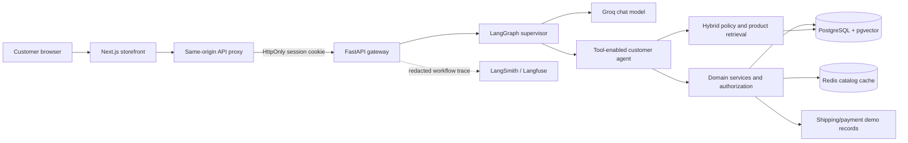
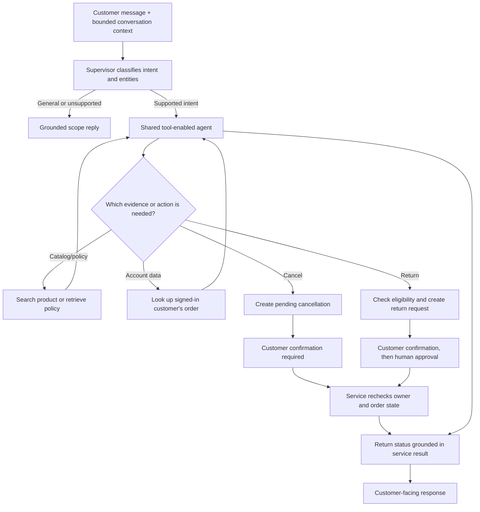
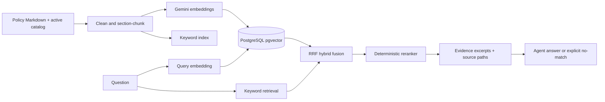

# ShopAssist AI — portfolio overview

## In one minute

ShopAssist is a portfolio e-commerce demo with a Next.js storefront, customer accounts, a FastAPI API, and a LangGraph support workflow. The agent uses Groq to interpret requests and select domain tools. Services read customer, order, catalog, payment-demo, return, and policy data from PostgreSQL; pgvector supports hybrid policy/product retrieval, and Redis caches catalog queries. Server-side identity checks scope private operations to the signed-in customer. Cancellation requires customer confirmation, and returns require customer confirmation plus a human approval step.

## Architecture

## Agent workflow

## Retrieval path

## Measured results

| Area | Result | What it means |
|---|---|---|
| Live routing | 110/110 (100%), up from 101/110 (91.8%) | Groq supervisor classification/routing on the project's 110-case dataset |
| RAG retrieval | Recall@1 90%; Recall@3/5 100%; MRR 0.95 | Ten known-answer questions; hybrid pgvector run matched keyword baseline |
| Security/deployment checks | 10 focused Phase 5 checks passed; Phase 4 report lists its focused checks | These checks do not establish production security |
| Full agent answer quality | 16/16 scored cases pass phrase-based answer and policy assertions; 16 tool selections, 14 applicable argument checks, 15 applicable executions | Small project-owned synthetic set; not an independent semantic evaluation or production reliability claim |
| Docker startup | Compose configuration validates; app API and storefront returned HTTP 200 locally | Docker daemon is inaccessible in this environment, so full Compose startup is still unverified |
| Support operations | 20/20 deterministic tool/safety checks; 3 isolated analytics/review tests | Sample database only; metrics describe recorded demo operations |

Detailed evidence: [routing evaluation](../evaluation/PHASE1_REPORT.md), [RAG evaluation](../evaluation/RAG_REPORT.md), [security report](../evaluation/PHASE4_SECURITY_REPORT.md), and [deployment report](../evaluation/PHASE5_DEPLOYMENT_REPORT.md).

## Important limits

- Product catalog, orders, payment status, and shipping events are demonstration data.
- Checkout creates an unpaid demo order. There is no payment gateway or real refund execution.
- There is no connected carrier API; tracking is read from demo data.
- Email verification needs working SMTP credentials.
- Admin access uses a shared key and needs replacement with staff roles before production.
- Rate limits and LLM metrics are currently process-local; multi-instance deployment needs shared storage.
- The MCP server is a local stdio integration, not a public multi-user MCP service.
- Never use this demo to process real customer payments or production personal data.
