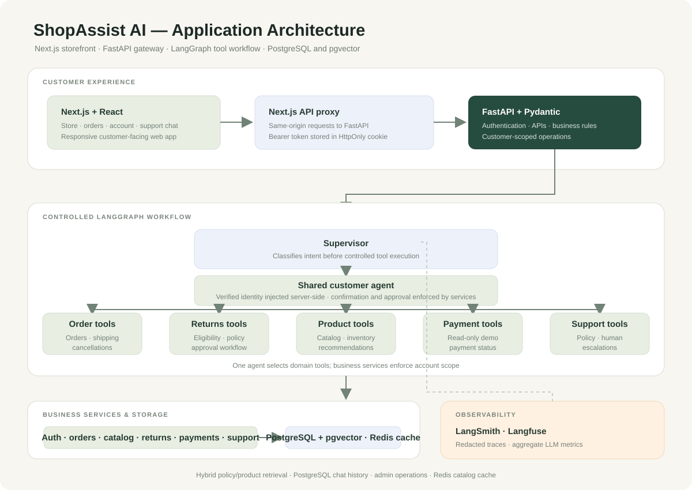

# ShopAssist AI: Evolving an E-Commerce Support Prototype

## From an early support prototype to a full-stack supervisor-agent application.

---

Let's be honest: most "AI agent" tutorials stop at "call OpenAI, get a response." That's not an agent. That's a chatbot with a fancy name.

A useful agent **reasons**, **acts**, and **observes**. It decides which tool to use, executes it, and uses the result to answer. Its workflow is traceable and testable; production use still requires stronger identity, security, and operational controls.

The first version of this project was a small support-agent prototype. It has since evolved into a full-stack application with a **Next.js and React storefront**, **FastAPI**, and a **single controlled LangGraph workflow** for intent classification, tools, and response generation.



> 🏗️ Full project on GitHub: [**github.com/m-peker/ecommerce-ai-agent**](https://github.com/m-peker/ecommerce-ai-agent)

> **Current implementation:** The older code snippets below document the initial prototype. The application now uses the Next.js + React interface and shared tool-enabled agent shown in the current architecture diagram.

---

## What We're Building

Imagine a customer typing into a chat window:

> *"Where is my package FDX-78901234?"*

The agent needs to:
1. Understand this is a shipping inquiry
2. Extract the tracking number
3. Query the shipping database
4. Return a clear, structured English response

Now multiply that by dozens of intent types, fuzzy queries ("my keyboard order"), edge cases (expired return windows), and you have a real-world AI agent problem.

---

## The Architecture

```text
Next.js + React storefront
        │
        ├── Same-origin API proxy (HttpOnly session cookie)
        ▼
FastAPI gateway → LangGraph supervisor → Shared tool-enabled agent → Response
                                              │
                                              └── Domain tools → Business services → SQLite/PostgreSQL

LangSmith and Langfuse capture redacted workflow node timing. PostgreSQL + pgvector, cited policy/product retrieval, persistent chat history, optional Redis catalog caching, and an admin operations dashboard are implemented.
```

**Stack:** Next.js + React (customer experience) · FastAPI (gateway) · LangGraph · SQLite default / PostgreSQL + pgvector supported · optional Redis cache · LangSmith + Langfuse (redacted workflow observability) · Gemini by default (Ollama/OpenAI optional)

---

## Why LangGraph?

LangGraph is a state-machine framework for building AI agents. Unlike LangChain's higher-level abstractions, LangGraph gives you explicit control over **nodes** (processing steps) and **edges** (transitions). The current graph classifies intent, routes to one shared tool-enabled agent, and formats the result. Account identity and approval gates are enforced by the API and business services.

Here's our graph:

```python
from langgraph.graph import StateGraph, END

workflow = StateGraph(AgentState)

workflow.add_node("triage", triage_node)      # Classify intent
workflow.add_node("tools", tool_node)          # Execute tools
workflow.add_node("response", response_node)   # Compose reply

workflow.set_entry_point("triage")

# Conditional routing: skip tools for general queries
workflow.add_conditional_edges(
    "triage",
    should_use_tools,    # returns "tools" or "response"
    {"tools": "tools", "response": "response"},
)

# Retry loop: if a tool fails, try again (up to 3 times)
workflow.add_conditional_edges(
    "tools",
    after_tools,         # returns "retry" or "response"
    {"retry": "tools", "response": "response"},
)

workflow.add_edge("response", END)
```

This gives us a **ReAct loop** (Reason → Act → Observe) baked into the graph structure:

```
Triage (reason) → Tool (act) → after_tools (observe) ──error?──→ Tool (retry)
                                  │
                                  └──success?──→ Response → END
```

---

## The Three Nodes

### 1. Triage Node — "What does the customer want?"

The triage node uses an LLM to classify the user's intent and extract structured entities:

```python
TRIAGE_PROMPT = """
You are an e-commerce customer support triage assistant.
Analyze the customer's message and classify it as JSON:

{
    "intent": "<order_status | shipping_tracking | return_request | ...>",
    "order_id": "<ORD-1001 or empty>",
    "tracking_number": "<FDX-78901234 or empty>",
    "customer_email": "<email or empty>"
}
"""
```

For *"Where is my package FDX-78901234?"*, it returns:

```json
{
  "intent": "shipping_tracking",
  "tracking_number": "FDX-78901234"
}
```

### 2. Tool Node — "Do the actual work."

This is where the magic happens. Instead of hardcoding which tool to call, we use **OpenAI function calling** — the LLM itself decides:

```python
# 7 tools, each decorated with @tool
ALL_TOOLS = [
    lookup_order,
    lookup_orders_by_email,
    search_orders,          # Search by product name or customer
    track_shipment,
    get_return_policy,
    check_return_eligibility,
    initiate_return,
]

# LLM with function-calling enabled
llm_with_tools = ChatOpenAI(model="gpt-4o-mini").bind_tools(ALL_TOOLS)

# LLM picks the right tool based on intent + context
ai_msg = llm_with_tools.invoke([system_prompt, *messages])

# Execute each tool the LLM requested
for tool_call in ai_msg.tool_calls:
    result = matching_tool.invoke(tool_call["args"])
```

This means the agent handles ambiguous queries naturally. *"Find my keyboard order"* → `search_orders("keyboard")`. No hardcoded rules.

### 3. Response Node — "Make it readable."

The response node takes the raw tool output and turns it into a natural, structured reply:

```python
RESPONSE_PROMPT = """
You are an English-only customer support agent.
Compose a friendly response using:
- Intent: {intent}
- Tool Results: {tool_results}

Rules:
- Only use data from tool results — never fabricate
- Structure with bullet points
- Include order/tracking numbers
- End with "Is there anything else I can help you with?"
"""
```

---

## The Tools

Each tool is a Python function decorated with `@tool` — automatically exposed to the LLM as a callable function.

| Tool | What It Does |
|---|---|
| `lookup_order(order_id)` | Fetches order details from SQLite |
| `lookup_orders_by_email(email)` | Lists all orders for a customer |
| `search_orders(query)` | Full-text search across orders |
| `track_shipment(tracking_number)` | Fetches carrier tracking + event history |
| `get_return_policy()` | Returns the return/refund policy |
| `check_return_eligibility(order_id)` | Validates 14-day window, delivery status |
| `initiate_return(order_id, reason)` | Creates RMA, calculates refund |

Each tool is independently testable — no LLM needed:

```python
def test_lookup_order():
    result = lookup_order.invoke({"order_id": "ORD-1001"})
    assert "James Wilson" in result
    assert "delivered" in result
```

---

## The Database

We use SQLite with realistic seed data — 12 orders across different statuses, 9 shipments from three carriers, and an on-demand returns table.

```sql
-- Sample: delivered order, within return window
INSERT INTO orders VALUES (
    'ORD-1001', 'James Wilson', 'james@example.com',
    '[{"product_name":"Wireless Headphones","sku":"SKU-501","quantity":1,"price":79.99}]',
    'delivered', 105.97, '2026-06-27', '742 Evergreen Terrace, Springfield, IL',
    'FDX-78901234'
);
```

The database auto-creates on first startup via `init_db()` — zero configuration needed.

---

## Redacted Workflow Observability

When configured, LangSmith and Langfuse record workflow stages and timing without uploading customer content:

```
Trace: shopassist.chat (completed, 1.2s)
├── graph.supervisor (0.5s)
├── graph.order_agent (0.6s)
└── graph.response (0.1s)
```

Traces include node names, timings, status, and an allowlisted intent category only. Prompts, chat messages, tool data, emails, and order IDs are excluded. Add the optional credentials from `.env.example` and restart FastAPI to enable either or both integrations.

```python
# src/observability/langfuse_setup.py
def init_langfuse():
    os.environ["LANGFUSE_PUBLIC_KEY"] = settings.langfuse_public_key
    os.environ["LANGFUSE_SECRET_KEY"] = settings.langfuse_secret_key
    from langfuse.langchain import CallbackHandler
    return CallbackHandler()

# src/api/routes.py
handler = get_langfuse_handler()
invoke_config["callbacks"] = [handler]
result = agent_graph.invoke(state, invoke_config)
client.flush()
```

This callback example belongs to the original prototype and is not used by the current application. The current implementation creates redacted workflow and node spans directly, so it does not export model prompts, chat messages, or tool payloads.

---

## Testing: 24 Tests, 1.5 Seconds

The test suite covers services, tools, and graph logic — all without LLM credentials:

```
tests/test_agent.py
├── TestOrderService (11 tests)
│   ├── CRUD operations
│   ├── Email lookup, product search
│   └── Return eligibility: delivered ✅, cancelled ❌, expired ❌
├── TestShippingService (3 tests)
├── TestReturnsService (2 tests)
├── TestAgentTools (5 tests)
└── TestGraph (3 tests)
```

```bash
$ pytest tests/ -q
........................  [100%]
24 passed in 1.33s
```

---

## Key Design Decisions

**Why 3 nodes?** Separation of concerns. Triage, Tool, and Response are independently testable, replaceable, and debuggable. Swap the LLM in one node without touching the others.

**Why SQLite?** Zero configuration, file-based, perfect for demos and prototypes. The service layer abstracts it — swap to PostgreSQL with a single file change.

**Why function calling over hardcoded routing?** A customer might say *"my keyboard order"* or *"the headphones I bought last week"* or *"order ORD-1002"*. Hardcoding rules for every phrasing is impossible. Letting the LLM choose the right tool handles all of them naturally.

**Why workflow tracing?** It makes slow graph nodes and failed stages visible while keeping customer and order data out of external trace payloads. Token usage and provider cost are not currently exported.

**Response language:** The customer-facing assistant is instructed to respond in clear English.

---

## Running It

```bash
git clone https://github.com/m-peker/ecommerce-ai-agent.git
cd ecommerce-ai-agent
python -m venv venv && venv\Scripts\activate
pip install -r requirements.txt
npm install
cp .env.example .env   # Add your GEMINI_API_KEY
python run.py          # Starts API + UI + opens browser
```

One command. Two servers. Ready in seconds.

---

## What I Learned

1. **LangGraph is the right abstraction.** State machines make agent behavior explicit. There's no mystery about what happens between user input and agent output.

2. **Function calling > hardcoded routing.** The LLM handles ambiguous queries better than any rule engine could.

3. **Observability from day one.** Langfuse caught integration issues during development that would have been invisible otherwise.

4. **Test without LLMs.** The service layer and tool logic are fully testable without API calls. Only the node integration tests need an LLM.

5. **Simple beats clever.** 3 nodes, 7 tools, 1 database. No microservices, no message queues, no distributed tracing. Just clean, focused code.

---

## What's Next?

- **Human-in-the-loop:** Require confirmation for high-value actions (returns > $500)
- **Multi-turn conversations:** Session memory across messages
- **Streaming responses:** SSE for real-time token-by-token output
- **Evaluation pipeline:** Langfuse scores for response quality

---

*Built with ❤️ for the agent-building community. Star the repo if you found this useful.*

**🔗 [github.com/m-peker/ecommerce-ai-agent](https://github.com/m-peker/ecommerce-ai-agent)**

---

*Follow me for more on AI agents, LLMs, and production ML.*
